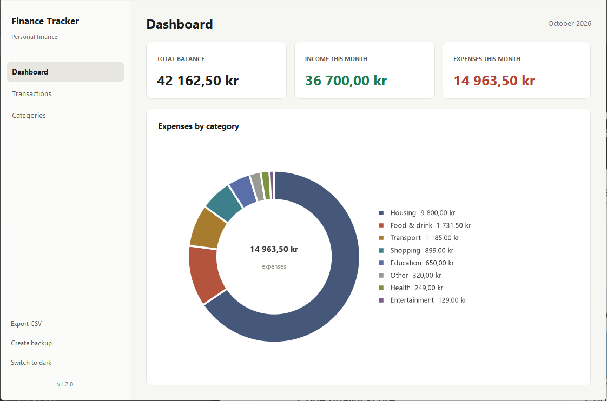
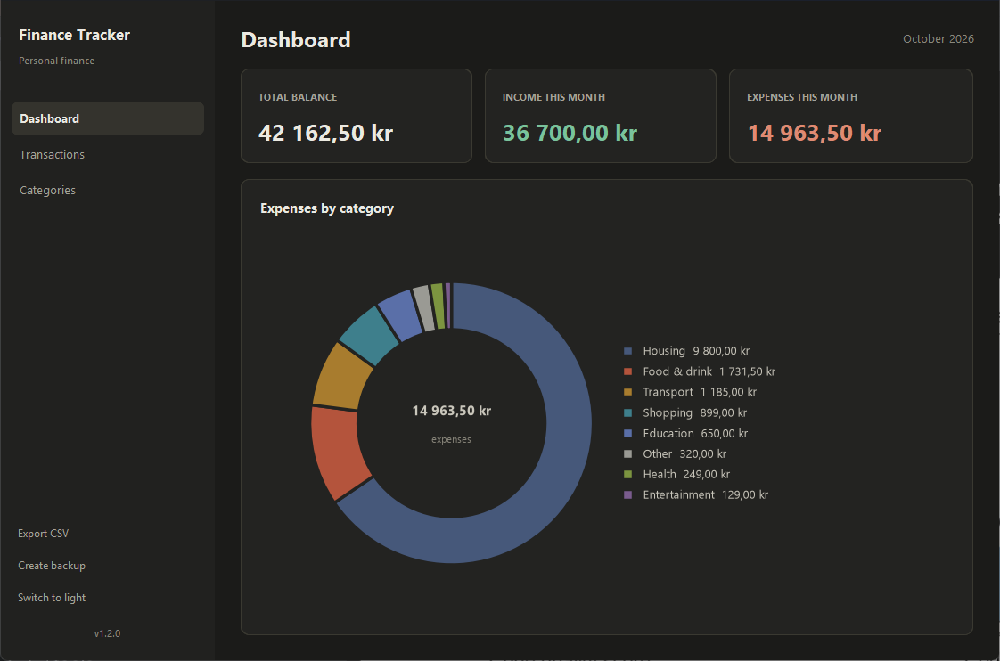
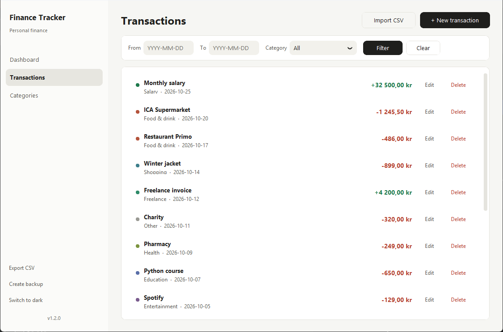
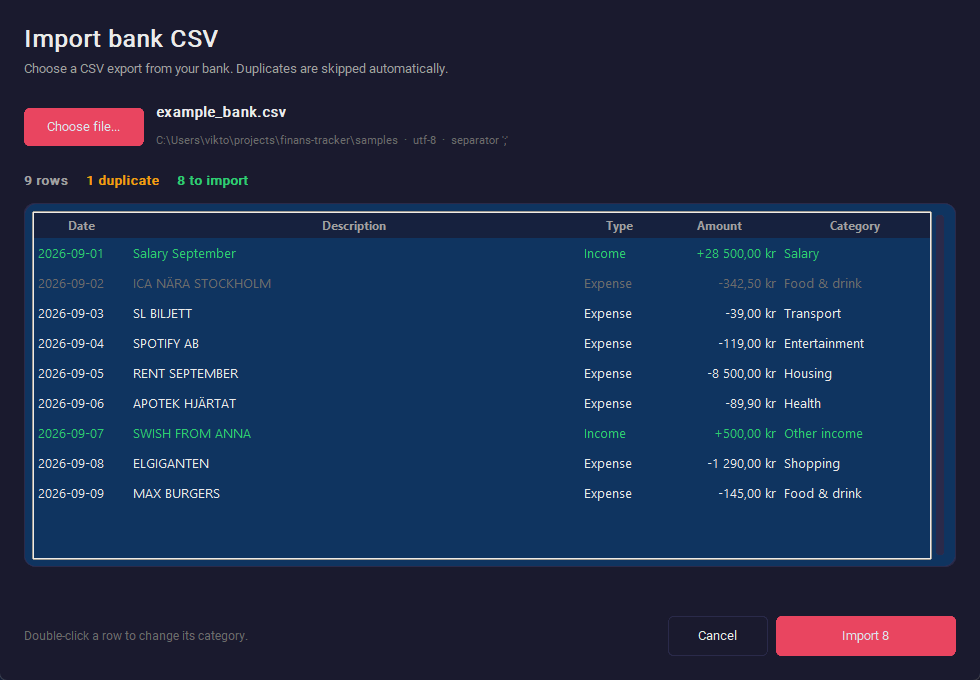

# Finance Tracker

A modern desktop application for personal finance management, built in Python with CustomTkinter.

## Download (Windows)

Download `FinanceTracker.exe` from the
[Releases page](https://github.com/KVJForce/finans-tracker/releases) and run it
— no Python installation is needed. Your data is stored in
`~/.finans_tracker/` on first start.

The file is not code-signed, so Windows SmartScreen may warn about it the
first time: click **More info** → **Run anyway**.

## Features

- **Dashboard** – Total balance, monthly income/expenses, and a donut chart by category
- **Transactions** – Add, edit, and delete income/expenses with filtering
- **Import** – Load bank CSV files with preview, automatic categorization, and duplicate protection
- **Categories** – Custom categories with color coding
- **Storage** – SQLite database with automatic daily backups
- **Export** – Export transactions to CSV
- **Themes** – Switch between dark and light mode

## Screenshots

| Light | Dark |
|-------|------|
|  |  |



## Requirements

- Python 3.10 or later
- Windows, macOS, or Linux

## Installation

1. Clone or download the project:

```bash
cd finans-tracker
```

2. Create and activate a virtual environment (recommended):

```bash
python -m venv venv

# Windows
venv\Scripts\activate

# macOS/Linux
source venv/bin/activate
```

3. Install dependencies:

```bash
pip install -r requirements.txt
```

## Running the application

```bash
python main.py
```

## Building the Windows executable

The repository includes a PyInstaller spec file that bundles the app into a
single `FinanceTracker.exe`:

```bash
pip install pyinstaller
pyinstaller FinanceTracker.spec
```

The executable is written to `dist/FinanceTracker.exe`. The `build/` and
`dist/` folders are not committed; releases carry the built binary.

## Importing bank CSV files

1. Open **Transactions** and click **Import CSV**.
2. Choose a CSV export from your bank.
3. Review the preview. Double-click a row to change its category.
4. Click **Import**.



The import:

- finds the header row even when the file has leading rows with account information
- supports `;`, `,`, tab, and `|` as delimiters
- reads UTF-8, UTF-16, and CP1252 (common in older Swedish bank exports)
- parses both Swedish and English date and amount formats
- uses the sign of the amount when the file has no type column
- skips duplicates based on date, amount, type, and description
- suggests categories using the rules in `finans_tracker/importers/rules.py`

Two example files are in `samples/`: `example_bank.csv` uses Swedish headers
and semicolons, `example_bank_english.csv` uses English headers and commas.
If the same purchase appears twice in a file, both rows are imported as long
as they are not already in the database.

### How the import works

The import is split into three steps so the logic can be tested without the
GUI:

1. `bank_csv.py` parses the file and creates `ParsedTransaction` objects.
2. `service.py` marks duplicates and suggests categories.
3. `import_dialog.py` shows the preview and saves the rows in a single
   database transaction.

## Tests

```bash
pip install -r requirements-dev.txt
python -m pytest
```

The tests cover amount and date formats, encodings, delimiters,
categorization, duplicate counting, and the database bulk import.

## Data and backups

All data is stored locally in:

- **Database:** `~/.finans_tracker/finans.db`
- **Backups:** `~/.finans_tracker/backups/` (last 10 copies)

A backup runs at startup (once per day) and on exit.

Databases created before the English translation used Swedish default
category names. On first start they are renamed to English automatically;
your transactions stay linked to the same categories. Colors that still
match an original default are refreshed to the current palette at the same
time — custom colors and renames are left untouched.

## Project structure

```
finans-tracker/
├── main.py                  # Entry point
├── FinanceTracker.spec      # PyInstaller build config
├── requirements.txt
├── requirements-dev.txt
├── README.md
├── assets/                  # App icon
├── samples/                 # Example bank CSV files
├── tests/                   # Tests for the import logic
└── finans_tracker/
    ├── app.py               # Main window
    ├── database.py          # SQLite handling
    ├── models.py            # Data models
    ├── backup.py            # Backups
    ├── export.py            # CSV export
    ├── theme.py             # Theme handling
    ├── importers/
    │   ├── bank_csv.py      # CSV parsing
    │   ├── categorizer.py   # Automatic categorization
    │   ├── normalize.py     # Amounts, dates, and text
    │   ├── rules.py         # Categorization rules
    │   └── service.py       # Duplicates and import flow
    └── ui/
        ├── dashboard.py
        ├── transactions.py
        ├── import_dialog.py # Import preview
        ├── categories.py
        └── components.py
```

## License

MIT
